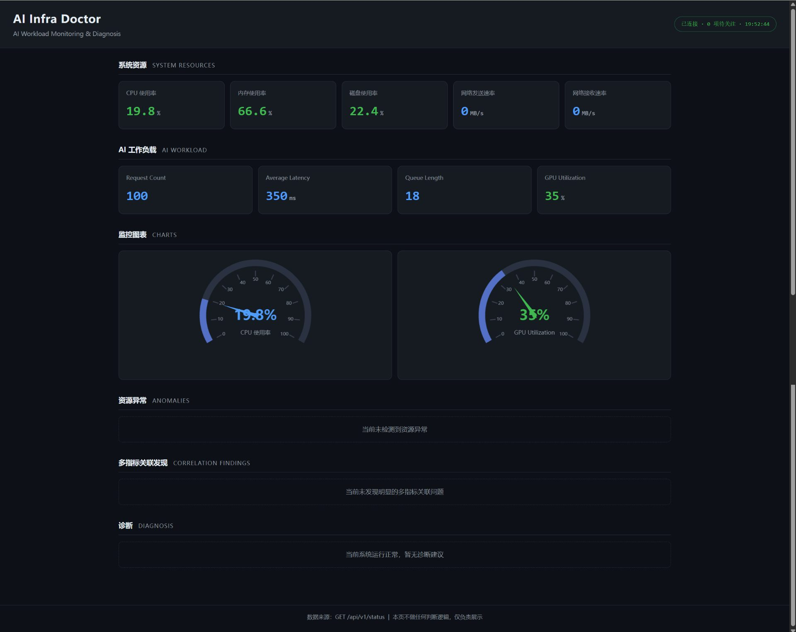

# AI Infra Doctor

面向 AI 工作负载的监控、异常检测、关联分析与故障诊断原型：采集系统资源与 AI 工作负载指标，经阈值检测、多指标关联分析和可解释规则诊断定位问题，并通过 FastAPI 接口与静态 Dashboard 呈现。

> **数据真实性说明（请先阅读）**
>
> - AI 工作负载指标（`request_count`、`avg_latency_ms`、`queue_length`、`gpu_utilization`）**是固定返回的模拟值**。
> - 项目**没有接入真实推理服务**，这四个指标不来自任何真实的推理后端。
> - **尚未实现真实 GPU 监控**，`gpu_utilization` 是模拟值，不是真实 GPU 采集结果。
> - 系统资源指标（CPU / 内存 / 磁盘 / 网络）来自本机 `psutil` 真实采集；其余结论均由固定规则推导，不是真实生产环境的监控数据。

> 当前进度：阶段 6C（统一状态 API + 静态 Dashboard + 2 秒自动刷新）。全链路 monitor/workload → detection/correlation → diagnosis 已打通并可视化，AI 不可用时自动降级。

## 核心功能

以下功能均已实现，并有测试覆盖：

- **系统资源监控** — `psutil` 采集 CPU / 内存 / 磁盘使用率，以及网络收发速率（MB/s）
- **AI 工作负载指标展示** — 请求数、平均延迟、队列长度、GPU 利用率四项（**当前为模拟数据**）
- **阈值异常检测** — CPU / 内存 / 磁盘固定阈值 90，严格大于才判定为异常
- **多指标关联分析** — 资源指标与工作负载指标交叉判断，当前实现「CPU 侧潜在瓶颈」场景
- **可解释规则诊断** — 每条结论都能追溯到明确的判断条件，没有黑盒过程
- **AI/LLM 辅助诊断接口** — 通过 OpenAI 兼容接口生成根因 / 风险 / 优化建议，不可用时降级且明确标记
- **Dashboard 可视化** — 零构建深色页面，指标卡 + ECharts 仪表盘 + 异常 / 关联 / 诊断列表
- **Dashboard 2 秒自动刷新** — 打开页面即持续更新，无需手动刷新
- **本地 ECharts** — 图表库随仓库分发，断网也能正常加载前端图表

## 技术架构

```text
  monitor.get_system_metrics()      workload.get_inference_metrics()
  系统资源指标 (psutil 真实采集)     AI 工作负载指标 (当前为模拟数据)
            │                                │
            └───────────────┬────────────────┘
                            ↓
              detection.detect_anomalies()    固定阈值检测（CPU/内存/磁盘 > 90）
                            ↓
              correlation.correlate()         多指标关联分析
                            ↓
              diagnosis.diagnose()            可解释规则诊断 + 关联发现
                            ↓
              ai/advisor.build_ai_context()   构造 AI 上下文与 Prompt
                            ↓
              ai/client.generate_ai_diagnosis()
                            ↓                LLM 根因 / 风险 / 建议
                            ↓                （可选，不可用时降级）
              FastAPI   GET /api/v1/status     统一只读 JSON 快照（不调用 LLM）
                            ↓
              前端 fetch + ECharts Dashboard 每 2 秒轮询一次
```

分层职责：

| 模块 | 职责 |
| --- | --- |
| `monitor/` | 采集系统资源指标 |
| `workload/` | 提供 AI 工作负载指标（**当前为模拟数据**） |
| `detection/` | 固定阈值异常检测 |
| `correlation/` | 多指标关联分析 |
| `diagnosis/` | 可解释规则诊断 |
| `ai/` | AI 上下文构造与 LLM 调用 |
| `app/` | FastAPI 应用与路由编排 |
| `frontend/` | 静态 Dashboard |

`/api/v1/status` 只做编排，不在本层重新实现任何判断逻辑，也**不会调用大模型**：打开该接口不需要 API Key、不产生费用、不受网络影响。AI 根因分析走独立的 `generate_ai_diagnosis()`，与规则链路解耦。

## Dashboard

启动服务后访问 <http://127.0.0.1:8000/dashboard> 即可打开监控页面。

<!-- TODO(截图待补充)：仓库中暂无可用的 Dashboard 截图文件。
     补充方式：把一张真实运行时的 Dashboard 截图保存为 docs/dashboard.png，
     然后取消下面这一行的注释即可显示。
      -->

> **📷 截图待补充**
>
> 本仓库当前不包含任何截图文件。这里**不会**放置示意图或伪造的渲染图。请提供一张**真实运行**的 Dashboard 截图，保存为 `docs/dashboard.png` 后取消上方注释即可显示。

页面包含以下区域：

| 区域 | 内容 |
| --- | --- |
| 顶部 | 项目标题、连接状态徽章、最后更新时间 |
| 系统资源 | CPU / 内存 / 磁盘 / 网络发送 / 网络接收 五张数字卡片 |
| AI 工作负载 | Request Count / Average Latency / Queue Length / GPU Utilization（**模拟值**） |
| 监控图表 | CPU 与 GPU 的 ECharts 仪表盘 |
| 资源异常 | 逐条显示 metric、value、threshold、message |
| 多指标关联发现 | 逐条显示 type、severity、message |
| 诊断 | 逐条显示 message，并用徽章区分「关联发现」与「规则诊断」 |

各区域都有对应的空状态文案（当前未检测到资源异常 / 未发现明显的多指标关联问题 / 系统运行正常）。

## 自动刷新

Dashboard 打开后会**自动每 2 秒请求一次 `/api/v1/status`**（`frontend/app.js` 中的 `REFRESH_INTERVAL = 2000`），无需手动刷新页面。顶部连接状态徽章与最后更新时间会随每次轮询更新。

实现要点：

- **前端不做任何业务判断**，只消费接口字段并渲染。阈值判断在 `detection`，关联判断在 `correlation`，诊断结论在 `diagnosis`。
- **图表实例只创建一次**，后续轮询通过 `setOption` 更新数据，不会反复销毁重建。
- **指标卡片 DOM 复用**，只更新文本内容。
- **请求失败时保留上一次的数据**，并在顶部徽章提示连接异常，不会白屏。
- 采用纯 `setInterval` 轮询，**没有** WebSocket / SSE。

> 该接口不调用 LLM，因此自动刷新**不会产生任何模型调用费用**，断网也不影响 Dashboard 展示规则链路的结果。

## 环境要求

- Python 3.13

## 安装依赖

### 运行项目

```bash
pip install -r requirements.txt
```

`requirements.txt` 只包含 4 个运行时依赖：`fastapi`、`uvicorn`、`psutil`、`httpx`。

### 运行测试

```bash
pip install -r requirements-dev.txt
python -m pytest tests/
```

`requirements-dev.txt` = `requirements.txt` + `pytest>=8.0.0`。`pytest` **只是开发/测试依赖**，没有写进 `requirements.txt`，部署生产环境时不需要安装它。

## 启动项目

```bash
uvicorn app.main:app --reload
```

启动后访问 <http://127.0.0.1:8000/>，接口应返回：

```json
{
  "project": "AI Infra Doctor",
  "status": "running"
}
```

## 系统资源监控

`monitor/system.py` 提供 `get_system_metrics()`，使用 [psutil](https://github.com/giampaolo/psutil) 采集当前机器的基础资源信息。

```python
from monitor.system import get_system_metrics

metrics = get_system_metrics()
# {
#   "cpu_percent": 35.2,
#   "memory_percent": 61.4,
#   "disk_percent": 72.1,
#   "network_sent_mb_per_sec": 0.35,
#   "network_recv_mb_per_sec": 2.18,
# }
```

| 字段 | 含义 | 单位 |
| --- | --- | --- |
| `cpu_percent` | CPU 使用率 | %，0-100 |
| `memory_percent` | 内存使用率 | %，0-100 |
| `disk_percent` | 系统磁盘使用率 | %，0-100 |
| `network_sent_mb_per_sec` | 网络发送速率 | MB/s |
| `network_recv_mb_per_sec` | 网络接收速率 | MB/s |

### 关于网络指标

网络指标表示的是**实时吞吐速率（MB/s）**，而不是系统启动以来的累计流量（MB）。

`psutil.net_io_counters()` 返回的原始数据是「开机以来的累计字节数」，这个数值只会一直变大，跑到 3000 MB 并不代表网络有异常，因此不能直接当作监控指标。`get_system_metrics()` 通过两次采样计算速率：

```text
速率 (MB/s) = (本次累计字节数 - 上次累计字节数) ÷ 真实时间间隔(秒) ÷ 1024 ÷ 1024
```

时间间隔使用真实测量值，不假设两次采样正好相隔 1 秒。

**注意**：因为速率需要「上一次」的采样数据做对比，**第一次调用时两个网络速率返回 `0.0`**，从第二次调用开始才是真实速率。

```python
from monitor.system import get_system_metrics

get_system_metrics()          # 第一次：网络速率为 0.0
get_system_metrics()          # 第二次：得到真实速率
```

该函数只负责采集和计算原始数据，**不做任何异常判断**。判断逻辑属于后续的 `detection` 模块。

## 阶段 2：基础异常检测

`detection/detector.py` 提供 `detect_anomalies(metrics)`，接收监控模块产出的指标字典，返回超过固定阈值的异常列表。

```python
from monitor.system import get_system_metrics
from detection.detector import detect_anomalies

anomalies = detect_anomalies(get_system_metrics())
# 全部正常时返回 []
# [
#   {"metric": "cpu_percent", "value": 95.2, "threshold": 90,
#    "message": "CPU 使用率过高"}
# ]
```

### 三个模块的职责分工

| 模块 | 回答的问题 | 例子 |
| --- | --- | --- |
| `monitor/` | 现在系统是什么状态？ | CPU = 95%，内存 = 60% |
| `detection/` | 这些指标有没有超过基础阈值？ | CPU 95% > 90 → CPU 异常 |
| `diagnosis/` | 根据这些异常，可能发生了什么？ | CPU 异常 → 可能是计算负载较高 |

### 当前检测方式：固定阈值

本阶段采用最简单的固定阈值检测，阈值定义在 `detection/detector.py` 顶部：

```python
CPU_THRESHOLD = 90
MEMORY_THRESHOLD = 90
DISK_THRESHOLD = 90
```

判断规则为 `指标 > 90 → 异常`，`指标 <= 90 → 正常`。注意是严格大于：**正好等于 90 视为正常**。

### 当前不检测网络

`network_sent_mb_per_sec` 和 `network_recv_mb_per_sec` 虽然存在于指标中，但本阶段**不参与异常检测**。多大的网络速率算异常，取决于具体的 AI 工作负载和业务场景，需要结合时间窗口和多指标关系判断，因此留到后续阶段设计。当前只检测 CPU、内存、磁盘三项。

### 后续可扩展方向（尚未实现）

- 多指标关联分析
- 时间窗口与历史基线
- 更智能的动态异常检测
- AI 故障诊断与优化建议

## 阶段 3：多指标关联与初步诊断

`diagnosis/diagnosis.py` 提供 `diagnose(metrics, anomalies)`，接收监控指标和已检测出的异常，输出"可能发生了什么"的初步判断。

```python
from monitor.system import get_system_metrics
from detection.detector import detect_anomalies
from diagnosis.diagnosis import diagnose

metrics = get_system_metrics()
anomalies = detect_anomalies(metrics)
diagnoses = diagnose(metrics, anomalies)
```

### 完整链路

系统现已形成从监控到诊断的初步链路：

```text
monitor.get_system_metrics()      现在系统是什么状态？
        ↓
detection.detect_anomalies()      哪些指标超过了基础阈值？
        ↓
diagnosis.diagnose()              根据这些异常，可能发生了什么？
```

### 当前诊断规则

| 条件 | 输出 type | 说明 |
| --- | --- | --- |
| `cpu_percent` 异常 | `cpu` | CPU 使用率过高，可能存在 CPU 计算负载较高 |
| `memory_percent` 异常 | `memory` | 内存使用率过高，可能存在内存资源紧张 |
| CPU 与内存**同时**异常 | `system` | CPU 和内存同时处于高负载状态，系统整体资源压力较大 |

CPU + 内存同时异常时返回 3 条诊断：CPU 诊断、内存诊断、综合诊断。

`disk_percent` 本阶段**不产出诊断**——目前还没有设计磁盘的具体根因判断。`anomalies` 为空时 `diagnose()` 返回 `[]`。

### 当前诊断基于可解释规则

现阶段诊断是**规则驱动**的：每一条结论都能追溯到明确的判断条件，没有任何黑盒过程。好处是结果可信、可复现、容易向他人解释。

Stage 4 之后将引入 AI，基于这些指标和异常做更深入的根因分析与优化建议。届时规则仍会保留，作为兜底和对照。

## 阶段 4A：AI 诊断输入构造

`ai/advisor.py` 提供两个函数，把上游三个阶段的结果整理成可以交给大模型的输入：

- `build_ai_context(metrics, anomalies, diagnoses)` → 结构化上下文（给程序用）
- `build_diagnosis_prompt(metrics, anomalies, diagnoses)` → 完整 Prompt 文本（给大模型用）

```python
from monitor.system import get_system_metrics
from detection.detector import detect_anomalies
from diagnosis.diagnosis import diagnose
from ai.advisor import build_ai_context, build_diagnosis_prompt

metrics = get_system_metrics()
anomalies = detect_anomalies(metrics)
diagnoses = diagnose(metrics, anomalies)

context = build_ai_context(metrics, anomalies, diagnoses)
prompt = build_diagnosis_prompt(metrics, anomalies, diagnoses)
```

### 当前架构

```text
monitor → detection → diagnosis → ai（输入构造）
                                        ↓
                              结构化上下文 + Prompt
```

Prompt 包含六部分：角色设定、系统指标（含单位）、检测到的异常、基础诊断结果、分析要求（根因 / 风险 / 建议）、权限限制，以及约定的 JSON 输出格式。

**本阶段还没有真正调用大模型**，也没有引入任何模型 SDK、API Key 或网络请求库。AI 层只负责"把上下文准备好"，真正的模型接入将在 Stage 4B 完成。

这样拆分的好处是：Prompt 的构造和效果验证可以完全离线进行，改 Prompt 不需要 API Key，也不会产生调用费用，测试全部用固定数据跑。

## 阶段 4B：LLM 智能诊断

`ai/client.py` 通过 **OpenAI 兼容接口**调用大模型，不绑定任何单一厂商。核心函数：

- `ask_llm(prompt) -> str` — 发请求，拿模型返回的原始文本
- `parse_ai_response(response) -> dict` — 解析并校验模型返回的 JSON
- `generate_ai_diagnosis(metrics, anomalies, diagnoses) -> dict` — 完整流程

```python
from monitor.system import get_system_metrics
from detection.detector import detect_anomalies
from diagnosis.diagnosis import diagnose
from ai.client import generate_ai_diagnosis

metrics = get_system_metrics()
anomalies = detect_anomalies(metrics)
diagnoses = diagnose(metrics, anomalies)

ai_result = generate_ai_diagnosis(metrics, anomalies, diagnoses)
# {
#   "summary": "...",
#   "root_cause": "...",
#   "risk": "...",
#   "recommendations": ["...", "..."],
#   "fallback": false
# }
```

### 完整链路

```text
monitor → detection → diagnosis → ai.context/prompt → LLM → AI 根因/风险/建议
```

### 配置

复制 `.env.example` 为 `.env` 并填入真实值，或直接设置环境变量：

| 变量 | 说明 |
| --- | --- |
| `AI_API_KEY` | 模型服务 API Key |
| `AI_BASE_URL` | OpenAI 兼容接口地址，通常带 `/v1` |
| `AI_MODEL` | 模型名称 |

三个变量**只从环境变量读取**，代码里没有任何硬编码密钥。切换模型服务商只需改这三个值，业务代码一行不动。

### AI 的作用

AI **不替代**监控和异常检测。monitor 提供事实，detection 给出确定性的阈值判断，diagnosis 给出可解释的规则结论——这些都不会因为 AI 不可用而失效。AI 是在这层结构化数据之上做三件事：

1. 分析可能的**根因**
2. 评估不处理可能带来的**风险**
3. 给出可执行的**优化建议**

### AI 只提供建议

AI 只能分析、解释、给建议，**不执行任何系统操作**：不终止进程、不改配置、不删文件、不重启服务、不做 docker/kubectl 操作、不安装软件。所有操作必须由人工判断后执行。

### 降级行为

模型 API 不可用时，`generate_ai_diagnosis()` 不会让项目崩溃，而是返回降级结果：

```json
{
  "summary": "AI 诊断暂时不可用",
  "root_cause": "", "risk": "", "recommendations": [],
  "fallback": true,
  "error": "缺少必要的环境变量：AI_API_KEY。..."
}
```

`fallback` 字段永远存在且明确标记这次是否拿到了真正的 AI 输出，**不会伪装成功**。这保证了评委现场即使没有网络，monitor / detection / diagnosis 依然能完整演示。

## 阶段 5A：AI 工作负载指标

`workload/inference.py` 提供 `get_inference_metrics()`，返回 AI 推理服务侧的工作负载指标。

```python
from workload.inference import get_inference_metrics

metrics = get_inference_metrics()
# {'request_count': 100, 'avg_latency_ms': 350.0,
#  'queue_length': 18, 'gpu_utilization': 35.0}
```

| 字段 | 含义 | 类型 | 单位 |
| --- | --- | --- | --- |
| `request_count` | 累计推理请求数 | int | 次 |
| `avg_latency_ms` | 平均推理延迟 | float | 毫秒 |
| `queue_length` | 等待处理的队列长度 | int | 个 |
| `gpu_utilization` | GPU 使用率 | float | %，0-100 |

### 当前为模拟数据

**Stage 5A 的这四个指标是固定返回的模拟值**，没有连接 GPU、CUDA、CANN 或任何外部服务。这样做的目的是先把数据结构打通，等后续阶段接入真实推理服务时，detection / diagnosis / ai 各层不需要改动。

### 为什么需要工作负载指标

`monitor/` 反映的是**机器资源**，`workload/` 反映的是**跑在上面的 AI 业务表现**。单看资源指标只能知道"机器忙不忙"，结合业务指标才能推断"忙得是否正常"：

```text
GPU 利用率高 + 队列变长 + 延迟升高   → 推理能力跟不上请求量
GPU 利用率低 + 延迟升高             → 更可能是 CPU / IO 瓶颈，而非算力不足
GPU 利用率低 + 队列长 + 延迟低     → 请求在进入推理前就被别的地方卡住了
```

这组多指标关联判断将在后续阶段实现，届时现有单阈值检测会作为兜底保留。

## 阶段 5B：多指标关联分析

`correlation/correlator.py` 提供 `correlate(metrics, workload, anomalies)`，把系统资源指标和 AI 推理工作负载指标放在一起，找它们之间的关联。

```python
from monitor.system import get_system_metrics
from workload.inference import get_inference_metrics
from detection.detector import detect_anomalies
from correlation.correlator import correlate

metrics = get_system_metrics()
workload = get_inference_metrics()
anomalies = detect_anomalies(metrics)

findings = correlate(metrics, workload, anomalies)
```

### 当前只实现一个场景：CPU 侧潜在瓶颈

四个条件**同时**满足才成立：

| 指标 | 条件 | 含义 |
| --- | --- | --- |
| `cpu_percent` | `> 90` | 机器 CPU 吃紧 |
| `gpu_utilization` | `< 50` | 但 GPU 却闲着 |
| `avg_latency_ms` | `> 200` | 推理延迟却很高 |
| `queue_length` | `> 10` | 而且请求还在堆积 |

这个组合说明瓶颈可能不在算力侧，而更可能在数据搬运、任务调度等由 CPU 承担的工作上。命中时返回：

```json
{
  "type": "cpu_bottleneck",
  "severity": "high",
  "message": "CPU 使用率较高，同时 GPU 利用率较低、推理延迟较高且请求队列较长，可能存在 CPU 侧数据处理或任务调度瓶颈。"
}
```

### 结论只是"可能"，不是根因

本层给出的是**关联线索**，措辞一律使用「可能存在」，不声称已经确定根因。判断依据是可解释的固定规则，任何人拿到输出都能对照上面的条件表复核。

### 当前数据与能力边界

- AI 推理工作负载指标仍然是 **Stage 5A 的模拟数据**，没有接入真实推理服务
- 尚未实现真实 GPU 监控，`gpu_utilization` 是模拟值
- 本层是**规则关联分析**，不是 AI 根因分析；深度根因推断仍由 Stage 4B 的 LLM 层承担

`correlate()` 只分析调用方传入的数据，不自行采集指标、不调用 detection、不调用 LLM，因此完全可离线测试。

## 阶段 5C：接入多指标关联诊断

关联发现从独立的分析层，接入了现有的诊断链和 AI 上下文层。

### 数据链路

```text
monitor  → 系统资源指标 ─┐
                        ├→ detection → 普通资源异常 ─┐
workload → AI 工作负载指标 ┘                          ├→ diagnosis → 综合诊断
                        └→ correlation → 关联发现 ──┘        ↓
                                                      ai/advisor → 完整 AI 上下文
```

### 两类结论的区分

| 类型 | 触发条件 | 特征 |
| --- | --- | --- |
| **普通规则诊断** | 单个指标超阈值 | `type` + `message` |
| **关联发现** | 多项指标组合成立 | `type` + `severity` + `message` + `source: "correlation"` |

关联发现在结果里带 `source: "correlation"` 标记，调用方可据此区分：

```python
for entry in diagnoses:
    if entry.get("source") == CORRELATION_SOURCE:
        ...  # 关联发现：可能的线索
    else:
        ...  # 普通规则诊断
```

### 调用方式

三个函数都向后兼容，新增参数可选，旧调用原样可用：

```python
from monitor.system import get_system_metrics
from workload.inference import get_inference_metrics
from detection.detector import detect_anomalies
from correlation.correlator import correlate
from diagnosis.diagnosis import diagnose
from ai.advisor import build_ai_context, build_diagnosis_prompt
from ai.client import generate_ai_diagnosis

metrics = get_system_metrics()
workload = get_inference_metrics()
anomalies = detect_anomalies(metrics)
findings = correlate(metrics, workload, anomalies)

diagnoses = diagnose(metrics, anomalies, findings)
context = build_ai_context(metrics, anomalies, diagnoses, findings)
prompt = build_diagnosis_prompt(metrics, anomalies, diagnoses, findings)
ai_result = generate_ai_diagnosis(metrics, anomalies, diagnoses, findings)
```

- `diagnose(metrics, anomalies)` — 旧调用，返回结构不变
- `build_ai_context(metrics, anomalies, diagnoses)` — 旧调用，返回仍只有三个键；**传入第四个参数时才会增加 `correlation_findings` 键**，保证旧代码不受影响
- `build_diagnosis_prompt(...)` — 新增「四、多指标关联发现」章节，并明确告知模型这些发现是**可能的线索，不是已确认的根因**
- `generate_ai_diagnosis(...)` — 只做参数透传，API Key 读取、请求方式、fallback 机制、JSON 解析、错误处理全部未改

本阶段只打通数据链路，没有新增任何依赖，也没有引入前端、Docker、数据库、GPU SDK、Agent 或自动修复能力。

## 阶段 6A：统一状态 API

为前端 Dashboard 提供一个**只读**接口，一次请求就能拿到整条诊断链路的结果。

### 接口

| 方法 | 路径 | 说明 |
| --- | --- | --- |
| GET | `/` | 服务存活检查 |
| GET | `/api/v1/status` | 完整诊断链路快照 |
| GET | `/docs` | 自动生成的 OpenAPI 文档 |

### GET /api/v1/status 返回

```json
{
  "metrics": { "cpu_percent": 95.2, "memory_percent": 93.5, "disk_percent": 70.0,
               "network_sent_mb_per_sec": 1.2, "network_recv_mb_per_sec": 2.5 },
  "workload": { "request_count": 100, "avg_latency_ms": 350.0,
                "queue_length": 18, "gpu_utilization": 35.0 },
  "anomalies": [ /* 普通资源异常 */ ],
  "correlation_findings": [ /* 多指标关联发现 */ ],
  "diagnoses": [ /* 综合诊断：规则诊断 + 关联发现 */ ]
}
```

### 调用链

```text
1. monitor.get_system_metrics()          → metrics
2. workload.get_inference_metrics()      → workload
3. detection.detect_anomalies(metrics)   → anomalies
4. correlation.correlate(m, w, a)        → correlation_findings
5. diagnosis.diagnose(m, a, f)           → diagnoses
6. 返回统一 JSON
```

严格按顺序执行，**任何一层都不跳过**，也不在本层重新实现任何判断逻辑——接口只做编排。

### 本接口不调用 LLM

`/api/v1/status` **不会主动调用大模型**。它只返回规则链路的结果：指标、阈值异常、关联发现、可解释诊断。

需要 AI 根因分析和优化建议时，走独立的 `generate_ai_diagnosis()`。这样设计的好处是：打开这个接口永远不需要 API Key、不花钱、不受网络影响，评委现场演示零风险。

本阶段没有新增任何依赖，也没有引入前端页面、ECharts、Docker、数据库、WebSocket、SSE、异步或自动刷新。

## 阶段 6B：静态监控 Dashboard

一个零构建步骤的深色监控页面，把 `GET /api/v1/status` 的数据可视化。

访问：启动服务后打开 <http://127.0.0.1:8000/dashboard>

### 页面区域

| 区域 | 内容 |
| --- | --- |
| 顶部 | 项目标题、连接状态 |
| 系统资源 | CPU / 内存 / 磁盘 / 网络发送 / 网络接收 五张数字卡片 |
| AI 工作负载 | Request Count / Average Latency / Queue Length / GPU Utilization |
| 监控图表 | CPU 与 GPU 的 ECharts 仪表盘 |
| 资源异常 | 逐条显示 metric、value、threshold、message |
| 多指标关联发现 | 逐条显示 type、severity、message |
| 诊断 | 逐条显示 message，并用徽章区分「关联发现」与「规则诊断」 |

各区域都有对应的空状态文案（当前未检测到资源异常 / 未发现明显的多指标关联问题 / 系统运行正常）。

### 数据流向

```text
浏览器加载页面
      ↓
fetch("/api/v1/status")          ← 页面加载时请求一次，随后每 2 秒自动轮询（阶段 6C）
      ↓
后端按序调用 monitor → workload → detection → correlation → diagnosis
      ↓
前端只做渲染，不做任何判断
```

**前端不实现任何业务逻辑**。阈值判断在 `detection`，关联判断在 `correlation`，诊断结论在 `diagnosis`。前端只消费接口字段并展示。

### ECharts 的加载策略

ECharts 采用**动态加载**，且**不在 HTML 里用 `<script>` 同步引入**。原因是 `echarts.min.js` 约 1MB，同步引入时浏览器会阻塞在下载上，后面的脚本根本不执行，页面一片空白。

现在的策略是：**先把数字渲染出来，再异步加载图表库，图表就绪后替换掉文字兜底**。因此即使网络很慢或图表库加载失败，Dashboard 的所有关键数字依然可读。

> 阶段 6C 已完成这一步：本地副本已放入 `frontend/vendor/echarts.min.js`，`app.js` 中的图表路径已改为 `/dashboard/vendor/echarts.min.js`，**不再依赖任何 CDN，断网也能加载图表**。

### 本阶段未实现

页面只在加载时请求一次，**没有自动刷新**（`setInterval`）、没有 WebSocket、没有 SSE、没有轮询。这些属于后续阶段。

> 以上为阶段 6B 完成时的状态。**阶段 6C 已补上 2 秒 `setInterval` 轮询**，见下方「阶段 6C：Dashboard 自动刷新」；WebSocket 与 SSE 至今**仍未实现**。

前端只用原生 HTML + CSS + JavaScript + ECharts，没有 React / Vue / Node.js / npm，也没有引入任何构建工具。

## 阶段 6C：Dashboard 自动刷新与图表本地化

给 Dashboard 加上 2 秒轮询，并把 ECharts 改为本地加载。详细说明见文档开头的「自动刷新」一节，这里只记录实现层面的要点：

| 改动 | 说明 |
| --- | --- |
| `REFRESH_INTERVAL = 2000` | 每 2 秒请求一次 `GET /api/v1/status` |
| 图表只创建一次 | 后续用 `setOption` 更新，不销毁重建实例 |
| 指标卡片 DOM 复用 | 只更新文本，不重建节点 |
| 失败降级 | 请求失败时保留上一次数据，顶部徽章提示，不白屏 |
| ECharts 本地化 | `frontend/vendor/echarts.min.js`（5.4.4，Apache-2.0），不再走 CDN |

本阶段**没有**改动后端接口结构，没有新增任何依赖，也没有引入 WebSocket / SSE。轮询接口 `/api/v1/status` 不调用 LLM，因此自动刷新不产生任何模型调用费用。

## 运行测试

先安装测试依赖：

```bash
pip install -r requirements-dev.txt
```

然后运行：

```bash
python -m pytest tests/
```

> 请使用 `python -m pytest` 而不是直接 `pytest`，这样项目根目录才会自动加入导入路径。

测试全部使用固定数据和 mock，**不需要网络、不需要 API Key、不会调用真实推理服务或 GPU**，也不产生任何模型调用费用。

## 目录结构

```text
AI-Infra-Doctor/
├── README.md
├── LICENSE                  # Apache-2.0
├── requirements.txt         # 运行时依赖
├── requirements-dev.txt     # 开发/测试依赖
├── .gitignore
├── .env.example
├── app/                     # FastAPI 应用入口与路由
├── monitor/                 # 系统资源采集（psutil）
├── workload/                # AI 工作负载指标（当前为模拟数据）
├── detection/               # 异常检测模块
├── correlation/             # 多指标关联分析
├── diagnosis/               # 故障诊断与优化建议模块
├── ai/                      # AI 上下文构造与 LLM 调用
├── frontend/                # 前端 Dashboard（静态资源）
│   └── vendor/              # 本地 ECharts
└── tests/                   # 测试
```

## 当前状态

| 模块 | 状态 |
| --- | --- |
| FastAPI 基础应用 | 已完成（`GET /`） |
| 监控模块 | 已完成（`get_system_metrics()`，采集 3 项使用率 + 2 项网络速率 MB/s） |
| 异常检测模块 | 已完成（`detect_anomalies()`，CPU/内存/磁盘固定阈值 90） |
| 故障诊断与建议模块 | 已完成（`diagnose()`，CPU/内存/组合三条可解释规则，不含 AI） |
| AI 诊断输入层 | 已完成（`build_ai_context()` + `build_diagnosis_prompt()`，未接入 LLM） |
| LLM 智能诊断 | 已完成（`generate_ai_diagnosis()`，OpenAI 兼容接口 + 降级兜底） |
| AI 工作负载指标 | 已完成（`get_inference_metrics()`，**模拟数据**，待接真实采集） |
| 多指标关联分析 | 已完成（`correlate()`，1 个规则场景：CPU 侧潜在瓶颈） |
| 关联诊断接入 | 已完成（关联发现已进入 diagnosis 与 AI 上下文，AI 层只透传） |
| 统一状态 API | 已完成（`GET /api/v1/status`，只读、不调用 LLM） |
| 静态 Dashboard | 已完成（`GET /dashboard`，零构建，本地 ECharts） |
| Dashboard 自动刷新 | 已完成（2 秒轮询 `GET /api/v1/status`，不调用 LLM） |
| Docker 部署 | 未开始 |
| 真实推理服务接入 | 未实现（AI 工作负载指标目前为模拟数据） |
| 真实 GPU 监控 | 未实现（`gpu_utilization` 目前为模拟值） |

## License

本项目采用 [Apache License 2.0](LICENSE)。

### 第三方组件

| 组件 | 用途 | 许可证 |
| --- | --- | --- |
| [FastAPI](https://github.com/fastapi/fastapi) | Web 服务框架 | MIT |
| [Uvicorn](https://github.com/encode/uvicorn) | ASGI 服务器 | BSD-3-Clause |
| [psutil](https://github.com/giampaolo/psutil) | 系统资源采集 | BSD-3-Clause |
| [httpx](https://github.com/encode/httpx) | 调用 OpenAI 兼容接口 | BSD-3-Clause |
| [Apache ECharts](https://github.com/apache/echarts) 5.4.4 | 前端图表，副本位于 `frontend/vendor/echarts.min.js` | Apache-2.0 |

本项目未使用任何模型厂商 SDK，LLM 调用统一通过 OpenAI 兼容接口完成。
